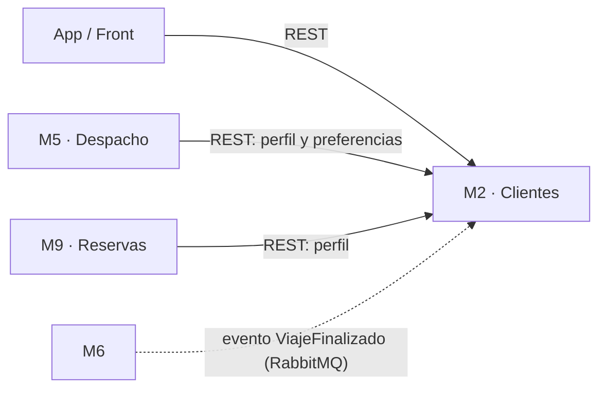
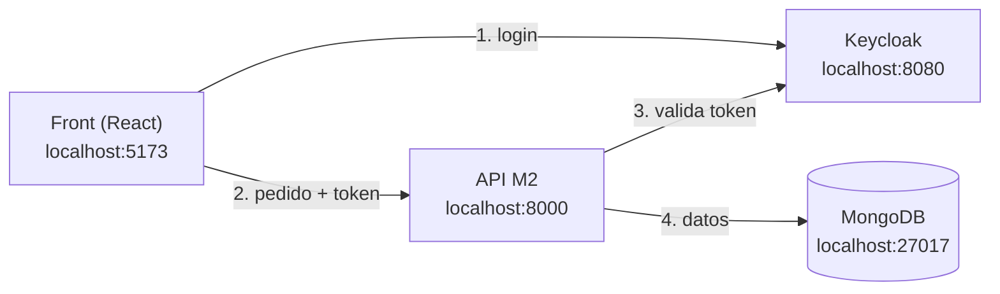

# 🚕 Plataforma de Movilidad Urbana — Módulo M2: Clientes

**Trabajo Práctico Integrador 2026**  
**Institución:** Universidad Tecnológica Nacional – Facultad Regional Resistencia (UTN FRRe)  
**Cátedra:** Desarrollo de Software  

> **En una línea:** M2 es el servicio que *conoce a los pasajeros*. Guarda quiénes son, a dónde suelen ir, cómo les gusta viajar y qué viajes hicieron, y le pasa esa info a los demás módulos cuando la necesitan.

---

## 👥 Equipo

| Integrante | Legajo |
|---|---|
| **Brandt, Carina Noemí** | 24672 |
| **Sonza, Matias Javier** | 26573 |
| **Paluch Ruberto, Julián** | 27229 |
| *[Nombre del Integrante 3]* | *[Legajo 3]* |

---

## 🤔 ¿De qué se trata?

La plataforma es una app de viajes tipo Uber/Cabify, dividida en **módulos** (M1, M2, M3…). Cada módulo es un **microservicio**: un programa independiente, con su propia base de datos, que se encarga de una sola parte del negocio y se comunica con los demás.

A nosotros nos toca **M2: Clientes**. Pensalo como la **"ficha del pasajero"**: todo lo que la plataforma necesita saber de la persona que pide el viaje.

### ¿Qué hace concretamente?

| Requisito | Qué significa en criollo |
|---|---|
| **RF-2.1 / RF-2.6** — Perfil y estado de cuenta | Alta, consulta y modificación de los datos del cliente (nombre, mail, teléfono). También saber si la cuenta está activa o bloqueada: un operador puede bloquear una cuenta, por ejemplo ante un reclamo. |
| **RF-2.2 / RF-2.3** — Direcciones y preferencias | Guardar lugares frecuentes ("Casa", "Facu", "Trabajo") para no escribirlos cada vez, y cómo le gusta viajar: tipo de vehículo, necesidades de accesibilidad, viaje silencioso, etc. |
| **RF-2.4** — Historial de viajes | Un resumen de los viajes que hizo el cliente. No lo calculamos nosotros: nos enteramos cuando otro módulo nos avisa que un viaje terminó. |
| **RF-2.5** — Calificar al conductor | El cliente puntúa al conductor. Si por un corte de internet la app manda la misma calificación dos veces, se guarda **una sola vez**. A eso se le dice ser **idempotente**. |

---

## 🔌 ¿Con quién habla M2?



Hay dos formas de comunicarse:

- **Síncrona (REST), línea llena:** alguien pregunta y M2 responde en el momento. Ejemplo: antes de asignar un conductor, **M5 (Despacho)** necesita saber si el pasajero pidió un vehículo con accesibilidad.
- **Asíncrona (eventos), línea punteada:** **M6** avisa *"terminó un viaje"* y sigue con lo suyo, sin esperar respuesta. Si M2 justo está caído, el mensaje queda guardado en la cola de RabbitMQ y lo procesamos cuando volvemos. Nadie se queda esperando a nadie.

Además, cada pedido que llega trae un **token de Keycloak** que dice quién es el usuario y qué rol tiene (`Cliente`, `Conductor` u `Operador`). Así sabemos, por ejemplo, que solo un operador puede bloquear una cuenta.

---

## 🧰 ¿Qué vamos a usar y para qué?

| Herramienta | Para qué la usamos | ¿Por qué esta? |
|---|---|---|
| **Python 3.12 + FastAPI** | Construir la API REST | Es rápido de escribir, valida los datos solo y genera la documentación interactiva (Swagger) automáticamente. |
| **Pydantic** | Definir cómo es un Cliente, una Dirección, etc. | Si alguien manda un mail mal escrito o le falta un campo, la API lo rechaza sola con un error claro, sin escribir validaciones a mano. |
| **MySQL** | Perfil y estado de cuenta | Datos con estructura fija y operaciones críticas (como bloquear una cuenta) que tienen que quedar consistentes. Una base relacional con transacciones es lo ideal. |
| **MongoDB** | Direcciones y preferencias | Un cliente puede tener 0 o 10 direcciones y preferencias distintas a las de otro. Un documento JSON flexible se adapta mejor que una tabla rígida. |
| **RabbitMQ** | Recibir eventos de otros módulos (ej. `ViajeFinalizado`) | Desacopla: los módulos no necesitan estar todos prendidos al mismo tiempo para comunicarse. |
| **Redis** | Caché de perfiles | M5 y M9 consultan perfiles todo el tiempo. Tenerlos en memoria evita ir a la base en cada pedido y las respuestas salen más rápido. |
| **Keycloak** | Login y roles | Es el servidor de identidad compartido por toda la plataforma (configurado en [keycloak/](keycloak/)). No reinventamos la autenticación: solo validamos el token. |
| **Docker + docker-compose** | Levantar todo con un comando | Todos corremos exactamente las mismas versiones. Generamos imágenes versionadas (formato estándar OCI), así "en mi máquina anda" deja de ser excusa. |

> 💡 Usar dos bases de datos distintas tiene nombre: **persistencia políglota**. La idea es simple: usar la herramienta adecuada para cada tipo de dato, en vez de meter todo a la fuerza en una sola.

### 12-Factor App, en dos patadas

El servicio sigue la metodología **12-Factor App** (RNF-06). En la práctica significa:

- **La configuración no va en el código.** URLs de las bases, contraseñas y puertos van en variables de entorno (`.env`). El mismo código corre en tu compu, en la de un compañero o en un servidor; lo único que cambia es el `.env`.
- **El servicio no guarda nada "adentro".** Todo lo importante vive en las bases de datos, así que podemos apagar el contenedor y levantar otro (o tres) sin perder información.
- **Dependencias explícitas.** Todo lo que hace falta para correrlo está en `requirements.txt` y en la imagen Docker.

---

## 🚦 ¿En qué estado está?

**Hecho**

- [x] API base con FastAPI y documentación Swagger
- [x] CRUD de clientes en MongoDB: alta, listado, consulta, modificación y baja, con direcciones y preferencias (RF-2.1, base de RF-2.2 / RF-2.3)
- [x] Validación de datos con Pydantic (incluye formato de email)
- [x] Validación del token de Keycloak en todos los endpoints
- [x] Reglas de propiedad: cada usuario solo ve, modifica o elimina su propio perfil (`403` si no es suyo)
- [x] CORS habilitado para el front (orígenes configurables con `CORS_ORIGINS`)
- [x] Front en React + Mantine con login de Keycloak para crear, editar y eliminar el perfil

**Pendiente**

- [ ] Contrato OpenAPI de M2 en el repo de la consigna (`contratos/m2_clientes/openapi.yml`) (RNF-03)
- [ ] Pasar el resto de la configuración a variables de entorno (`.env`): URL de MongoDB y de Keycloak (RNF-06)
- [ ] Estado de cuenta y bloqueos administrativos, con permisos por rol Operador (RF-2.6)
- [ ] Preferencias de tipo de vehículo, comunicación y accesibilidad (RF-2.3)
- [ ] Calificación del conductor sin duplicados por viaje (RF-2.5)
- [ ] Historial de viajes obtenido desde M6 (RF-2.4)
- [ ] Unicidad de email y de usuario de Keycloak por perfil
- [ ] Pruebas unitarias y de integración (RNF-07)
- [ ] Dockerizar la API y el front (hoy solo MongoDB y Keycloak corren en Docker) (RNF-04)
- [ ] Caché de perfiles con Redis y eventos con RabbitMQ (TP2)

---

## 🚀 Cómo instalarlo y correrlo (Windows)

Hay que levantar cuatro piezas: **Keycloak** (login), **MongoDB** (base de datos), la **API de M2** y el **front**. Keycloak y MongoDB corren en Docker; la API en Python y el front en Node.js.



### 1. Instalar (una sola vez)

| Programa | Para qué | Cómo verificar |
|---|---|---|
| [Docker Desktop](https://www.docker.com/products/docker-desktop/) — versión **AMD64** (Intel o AMD), ARM64 solo para procesadores ARM | Corre Keycloak, Postgres y MongoDB | `docker --version` |
| **WSL** — Docker lo pide la primera vez que se abre. En PowerShell **como administrador**: `wsl --install` y reiniciar la PC | Docker lo necesita en Windows | `wsl --status` |
| [Python](https://www.python.org/downloads/windows/) **3.12 o 3.13** — ⚠️ **no** 3.14/3.15: algunas librerías todavía no tienen versión para ellas y `pip install` falla pidiendo "Microsoft Visual C++" | Corre la API | `py list` o `python --version` |
| [Node.js](https://nodejs.org) **LTS** (22.12 o superior) | Corre el front; trae `npm` | `node --version` |

Con el instalador nuevo de python.org se puede agregar la 3.13 con `py install 3.13`.

### 2. Levantar Keycloak y MongoDB

Abrir Docker Desktop y esperar a que diga **Engine running**. Después, en PowerShell:

```powershell
cd C:\Proyectos\2026-01-TPI\keycloak
docker compose up -d

cd ..\m2-clientes
docker compose up -d

docker ps        # tienen que aparecer keycloak, postgres y mongo
```

- `docker compose up -d` lee el `docker-compose.yml` de la carpeta, descarga las imágenes la primera vez y deja los contenedores corriendo en segundo plano (`-d`).
- Keycloak tarda 30-60 segundos en arrancar. Se prueba en http://localhost:8080 (consola de administración: `admin` / `ds2026`).

### 3. Configurar Keycloak (una sola vez, en tu Keycloak local)

Entrar a http://localhost:8080 → **Administration Console** (`admin` / `ds2026`) → elegir el realm **ds-2026-realm** arriba a la izquierda.

**a) Cliente para el front** — **Clients → Create client**. El asistente tiene 3 pantallas:

1. *General settings*: Client type `OpenID Connect`, Client ID **`m2-frontend`** → Next
2. *Capability config*: **Client authentication: Off** (así es público, sin secreto) y solo **Standard flow** tildado → Next
3. *Login settings*:
   - Valid redirect URIs: `http://localhost:5173/*`
   - Valid post logout redirect URIs: `http://localhost:5173/*`
   - Web origins: `http://localhost:5173`
   - **Save**

Después se pueden revisar en *Clients → m2-frontend → Settings → Access settings*.

**b) Contraseña del usuario de prueba** — **Users → cliente-demo → Credentials → Reset password**: poner una contraseña (por ejemplo `ds2026`), **Temporary: Off** → Save. El usuario `cliente-demo` tiene rol *Cliente*.

**c) (Opcional) Tokens más largos** — por defecto duran 5 minutos. *Realm settings → Tokens → Access Token Lifespan* = 1 hora → Save.

> Estos cambios quedan en la base de Keycloak de cada uno. Si se borra con `docker compose down -v`, hay que repetirlos.

### 4. Correr la API de M2 (ventana de PowerShell 1)

La primera vez:

```powershell
cd C:\Proyectos\2026-01-TPI\m2-clientes
py -3.13 -m venv venv                 # crea el entorno virtual con Python 3.13
.\venv\Scripts\Activate.ps1           # lo activa: la línea empieza con (venv)
pip install -r requirements.txt       # instala las librerías
uvicorn main:app --reload             # arranca la API en http://localhost:8000
```

Las veces siguientes alcanza con:

```powershell
cd C:\Proyectos\2026-01-TPI\m2-clientes
.\venv\Scripts\Activate.ps1
uvicorn main:app --reload
```

- Si al activar dice *"la ejecución de scripts está deshabilitada"*: `Set-ExecutionPolicy -Scope CurrentUser RemoteSigned` (una vez) y volver a activar.
- Si dice *"uvicorn no se reconoce"*: no estás en `m2-clientes` o no activaste el `venv`.
- Las líneas `GET / 404 Not Found` y `GET /favicon.ico 404` son normales: la API no tiene página en `/`.
- Documentación interactiva (Swagger): http://localhost:8000/docs

### 5. Correr el front (ventana de PowerShell 2)

```powershell
cd C:\Proyectos\2026-01-TPI\frontend
npm install        # solo la primera vez o si cambió package.json
npm run dev        # arranca el front en http://localhost:5173
```

Abrir **http://localhost:5173** → redirige al login de Keycloak → entrar con `cliente-demo` y la contraseña del paso 3b. Ahí se crea, edita o elimina el perfil. Más detalle en [frontend/README.md](frontend/README.md).

### 6. (Opcional) Probar la API sin el front

Pedir un token con la cuenta de servicio del grupo (rol Operador) y copiarlo al portapapeles:

```powershell
$r = Invoke-RestMethod -Method Post -Uri "http://localhost:8080/realms/ds-2026-realm/protocol/openid-connect/token" -Body @{ grant_type="client_credentials"; client_id="grupo-01"; client_secret="68230b9a-f540-4e16-9f56-19180f303676" }; $r.access_token | Set-Clipboard
```

En http://localhost:8000/docs → **Authorize** → pegar el token → probar los endpoints con **Try it out → Execute**. Si responde `"El token ha expirado"`, pedir otro y en Authorize hacer Logout y pegar el nuevo.

### Para apagar todo

- Ctrl+C en las ventanas de uvicorn y de `npm run dev`.
- `docker compose down` en `keycloak` y en `m2-clientes`. **No** usar `down -v`: borra los datos.

### Problemas comunes

| Problema | Solución |
|---|---|
| Docker: *"WSL is not installed"* | PowerShell como administrador → `wsl --install` → reiniciar |
| `pip install` falla con *"Microsoft Visual C++ 14.0 is required"* | Estás en Python 3.14/3.15. Borrar `venv` (`Remove-Item -Recurse -Force venv`) y recrearlo con `py -3.13 -m venv venv` |
| *"port is already allocated"* | Otro programa usa el puerto 8080, 27017, 8000 o 5173 |
| El front dice que no puede conectar con Keycloak | Keycloak no está corriendo o falta el cliente `m2-frontend` (paso 3a) |
| El front no carga el perfil (error de red/CORS) | La API no está corriendo, o hay que reiniciar uvicorn después de actualizar el código |
| Keycloak no muestra el realm `ds-2026-realm` | En `keycloak`: `docker compose down -v` y `docker compose up -d` (se pierde la configuración del paso 3) |

### Endpoints disponibles hoy

| Método | Ruta | Qué hace |
|---|---|---|
| `POST` | `/api/v1/clientes` | Crea un cliente con sus direcciones y preferencias |
| `GET` | `/api/v1/clientes` | Lista los clientes del usuario del token |
| `GET` | `/api/v1/clientes/{id_mongo}` | Trae un cliente por su ID (`400` ID inválido, `403` no es tuyo, `404` no existe) |
| `PUT` | `/api/v1/clientes/{id_mongo}` | Reemplaza los datos del cliente |
| `DELETE` | `/api/v1/clientes/{id_mongo}` | Elimina el cliente |

Todos requieren el encabezado `Authorization: Bearer <token>`.

Ejemplo de cliente para crear con el `POST`:

```json
{
  "nombre": "Ana",
  "apellido": "Gómez",
  "email": "ana.gomez@gmail.com",
  "telefono": "3624123456",
  "direcciones": [
    {
      "etiqueta": "Casa",
      "calle": "Av. Sarmiento",
      "numero": "1500",
      "ciudad": "Resistencia",
      "es_principal": true
    }
  ],
  "preferencias": {
    "viaje_silencioso": true,
    "temperatura_aire": "Fría",
    "musica": "Rock"
  }
}
```

---

## 📁 Estructura del repo

```
2026-01-TPI/
├── keycloak/                 # Servidor de identidad (login y roles) + configuración del realm
├── frontend/                 # Front en React + Vite + Mantine (login con Keycloak)
└── m2-clientes/              # Nuestro microservicio
    ├── main.py               # Endpoints de la API
    ├── models.py             # Cómo es un Cliente, una Dirección y las Preferencias
    ├── database.py           # Conexión a MongoDB
    ├── security.py           # Validación del token de Keycloak
    ├── requirements.txt      # Librerías de Python
    └── docker-compose.yml    # MongoDB local
```

---

<details>
<summary><b>📖 Mini glosario (para quien no viene del palo)</b></summary>

- **Microservicio:** un programa chico e independiente que hace una sola cosa bien y se comunica con otros por la red.
- **API REST / endpoint:** la "ventanilla" del servicio. Cada endpoint es una URL a la que le pedís algo (`GET` para consultar, `POST` para crear, etc.).
- **Evento / cola de mensajes:** un aviso que un servicio deja en una cola ("terminó un viaje") para que otro lo lea cuando pueda.
- **Caché:** una copia rápida en memoria de datos que se piden seguido, para no ir a buscarlos a la base cada vez.
- **Contenedor (Docker):** una "cajita" que trae el programa con todo lo que necesita para correr, igual en cualquier máquina.
- **Token:** una credencial digital que dice quién sos y qué permisos tenés, sin mandar la contraseña en cada pedido.
- **Idempotente:** que hacer la misma operación una o diez veces da el mismo resultado.

</details>
