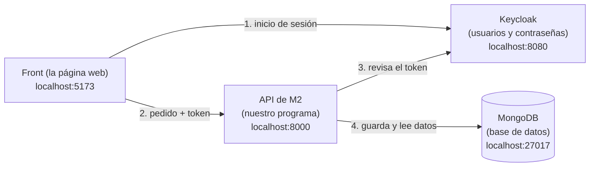

# Primeros pasos: tener M2 funcionando en tu PC

Esta guía es para quien nunca trabajó en este proyecto, o tiene poca experiencia en programación. Al terminarla vas a:

- tener el sistema completo corriendo en tu computadora;
- haber entrado como cliente y haber probado la API;
- saber cómo está organizado el repo;
- estar listo para empezar tu tarea ([tablero de tareas](tareas/README.md)).

**Tiempo estimado:** entre 1 y 2 horas la primera vez, casi todo esperando descargas.

> Si algo falla, copiá el error completo y pegáselo a la IA junto con esta guía. Si en 20 minutos no salió, preguntá en el grupo. Al final hay una sección con los problemas más comunes.

---

## 0. Qué vas a levantar (2 minutos de lectura)

M2 es el módulo de **clientes** de una plataforma de viajes tipo Uber. Para que funcione hacen falta cuatro piezas:



| Pieza | Qué es | Cómo corre |
|---|---|---|
| **Keycloak** | Maneja el inicio de sesión: usuarios, contraseñas y roles. Hace de M1. | En Docker |
| **MongoDB** | La base de datos donde M2 guarda perfiles, direcciones, etc. | En Docker |
| **API de M2** | Nuestro programa, en Python. Recibe pedidos y responde con datos. | En tu PC con Python, o en Docker |
| **Front** | La página web que usa el cliente, en React. | En tu PC con Node, o en Docker |

**Docker** es un programa que corre otros programas "empaquetados" (contenedores), sin que tengas que instalarlos uno por uno.

---

## 1. Instalar los programas (una sola vez)

Marcá cada uno cuando lo tengas. Para verificar, abrí **PowerShell** (tecla Windows, escribí "PowerShell") y corré el comando de la última columna.

- [ ] **Git**: https://git-scm.com/download/win. Dejá todas las opciones por defecto. Verificá con `git --version`.
- [ ] **Docker Desktop**: https://www.docker.com/products/docker-desktop/. Elegí la versión **AMD64** (casi todas las PC; ARM64 solo si tu procesador es ARM). Docker pide **WSL** la primera vez: si te lo pide, abrí PowerShell **como administrador**, corré `wsl --install` y reiniciá. Verificá con `docker --version`.
- [ ] **Python 3.13** (o 3.12): https://www.python.org/downloads/windows/. ⚠️ **No** instales 3.14 o más nuevo, porque algunas librerías todavía no funcionan. En el instalador tildá **"Add python.exe to PATH"**. Verificá con `py -3.13 --version`.
- [ ] **Node.js LTS** (22 o más nuevo): https://nodejs.org. Verificá con `node --version`.
- [ ] **Visual Studio Code** (recomendado, para ver y editar el código): https://code.visualstudio.com.
- [ ] **Cuenta de GitHub**, y que Lucas te haya agregado al repo `FRRe-DS/2026-01-TPI`. Si no te llegó la invitación, pedísela.

Después de instalar todo, **cerrá y volvé a abrir PowerShell**, para que reconozca los programas nuevos.

---

## 2. Bajar el repo

```powershell
mkdir C:\Proyectos
cd C:\Proyectos
git clone https://github.com/FRRe-DS/2026-01-TPI.git
cd 2026-01-TPI
git switch desarrollo-m2
```

- `git clone` baja una copia del repo a tu PC. La primera vez puede abrir el navegador para que inicies sesión en GitHub.
- `git switch desarrollo-m2` te lleva a la rama donde se junta el trabajo de todos. **Siempre se trabaja a partir de esta rama, nunca sobre `main`.**

Configurá tu nombre y tu mail, una sola vez, para que tus commits digan quién los hizo:

```powershell
git config --global user.name "Tu Nombre"
git config --global user.email "tu-mail@ejemplo.com"
```

- [ ] Tengo la carpeta `C:\Proyectos\2026-01-TPI` y estoy en `desarrollo-m2` (`git branch` muestra un `*` al lado).

---

## 3. Levantar Keycloak y MongoDB (Docker)

1. Abrí **Docker Desktop** y esperá a que abajo a la izquierda diga **Engine running**.
2. En PowerShell:

```powershell
cd C:\Proyectos\2026-01-TPI\keycloak
docker compose up -d

cd ..\m2-clientes
docker compose up -d

docker ps
```

La primera vez tarda porque descarga las imágenes. `docker ps` tiene que mostrar tres contenedores: keycloak, postgres y mongo.

3. Keycloak tarda entre 30 y 60 segundos en arrancar. Abrí http://localhost:8080: tiene que aparecer la página de Keycloak.

- [ ] `docker ps` muestra los tres contenedores y http://localhost:8080 abre.

---

## 4. Configurar Keycloak (una sola vez)

Seguí el **paso 3 del [README](../README.md#3-configurar-keycloak-una-sola-vez-en-tu-keycloak-local)** (secciones a, b y b2). Ahí se crea el cliente del front, se le pone contraseña a `cliente-demo` y se crean los roles. Hacelo con calma: es el paso donde más gente se equivoca.

> Cuando esté mergeada la tarea [T06](tareas/T06-keycloak-usuarios-y-roles.md), este paso va a venir hecho solo.

- [ ] Hice los pasos 3a, 3b y 3b2 del README.

---

## 5. Correr la API de M2

En una ventana de PowerShell **nueva**, que va a quedar abierta mientras trabajes:

```powershell
cd C:\Proyectos\2026-01-TPI\m2-clientes
py -3.13 -m venv venv
.\venv\Scripts\Activate.ps1
pip install -r requirements.txt -r requirements-dev.txt
uvicorn main:app --reload
```

Qué hace cada línea:
- `py -3.13 -m venv venv` crea un **entorno virtual**: una carpeta con las librerías de este proyecto, separadas de las del resto de tu PC.
- `.\venv\Scripts\Activate.ps1` lo activa. A partir de ahí, la línea de PowerShell empieza con `(venv)`.
- `pip install ...` instala las librerías. Las de `requirements-dev.txt` son para las pruebas.
- `uvicorn main:app --reload` arranca la API. `--reload` hace que se reinicie sola cuando cambiás el código.

Abrí http://localhost:8000/docs: es **Swagger**, la página donde se ven y se prueban todos los endpoints de la API.

**Las próximas veces** alcanza con:
```powershell
cd C:\Proyectos\2026-01-TPI\m2-clientes
.\venv\Scripts\Activate.ps1
uvicorn main:app --reload
```

- [ ] http://localhost:8000/docs abre y `GET /health` responde `200`.

---

## 6. Correr el front

En **otra** ventana de PowerShell:

```powershell
cd C:\Proyectos\2026-01-TPI\frontend
npm install
npm run dev
```

Abrí http://localhost:5173 → **Ya tengo cuenta, ingresar** → entrá con `cliente-demo` y la contraseña que pusiste en el paso 4 → creá el perfil.

- [ ] Entré como `cliente-demo`, creé el perfil y cargué una dirección.

---

## 7. Correr las pruebas

En la ventana de la API (cortala con `Ctrl+C`, o abrí otra con el `venv` activado):

```powershell
cd C:\Proyectos\2026-01-TPI\m2-clientes
python -m pytest
```

Tiene que terminar con algo como `214 passed`. Las pruebas **no necesitan** Keycloak ni MongoDB: usan una base en memoria y tokens de prueba.

- [ ] Las pruebas pasan.

---

## 8. Probar como operador desde Swagger (opcional, recomendado)

Así ves cómo se usa la API con un token. Seguí el **paso 6 del [README](../README.md#6-opcional-probar-la-api-sin-el-front)**: pedís un token de operador, lo pegás en **Authorize** de Swagger y consultás el perfil de `cliente-demo`. Si querés, bloquealo y mirá el aviso en el front.

---

## 9. Conocer el repo (15 minutos)

Abrí la carpeta en VS Code (`code C:\Proyectos\2026-01-TPI`) y mirá:

| Dónde | Qué hay |
|---|---|
| `README.md` | Explicación general, instalación y estado del módulo. |
| `AGENTS.md` | Cómo está hecho el proyecto y sus reglas. **Pasáselo a la IA** cada vez que le pidas ayuda. |
| `contratos/m2_clientes/openapi.yml` | El **contrato**: qué rutas tiene M2, qué datos recibe y devuelve. Lo compartimos con el Grupo 17 y no se cambia por cuenta propia. |
| `m2-clientes/` | La API: `main.py` la arma, `rutas/` tiene un archivo por recurso (perfil, direcciones, bloqueos...), `models.py` los datos, `security.py` el control de tokens y roles, `tests/` las pruebas. |
| `frontend/src/` | El front: `App.jsx` es la pantalla principal, `api.js` habla con la API y `components/` tiene las tarjetas. |
| `keycloak/` | La configuración de Keycloak. |
| `docs/tareas/` | El tablero y las guías de las tareas que faltan. |

Un buen ejercicio: pedile a la IA *"Te paso `AGENTS.md` y `m2-clientes/rutas/direcciones.py`: explicame cómo funciona, función por función, como para alguien que empieza"*.

---

## 10. Cómo se trabaja con Git en el equipo

Todos los comandos se corren desde la **raíz del repo** (`C:\Proyectos\2026-01-TPI`), no desde `frontend` ni `m2-clientes`.

```powershell
# 1. Traer lo último y crear tu rama
git switch desarrollo-m2
git pull
git switch -c feature/t01-m6-simulado        # el nombre de tu tarea

# 2. Trabajar y guardar de a poco
git add -A
git commit -m "Qué hiciste, en una frase"
git push -u origin feature/t01-m6-simulado   # la primera vez; después alcanza con git push

# 3. En GitHub: Pull requests → New pull request
#    base: desarrollo-m2  ←  compare: tu rama
```

> **⚠️ Revisá la base del PR.** GitHub propone `main` por defecto. Antes de tocar "Create pull request", cambiá arriba la **base** a `desarrollo-m2` (tiene que decir `base: desarrollo-m2 ← compare: tu-rama`). Si el PR ya está abierto con base `main`, no lo mergees: tocá **Edit** al lado del título y cambiá la base.

- Cada push dispara el **CI**: GitHub corre las pruebas solo. En el PR vas a ver tildes verdes ✔ o cruces rojas ✖.
- Lucas revisa el PR y se mergea con **"Create a merge commit"**.

---

## Problemas comunes

| Mensaje o síntoma | Qué hacer |
|---|---|
| `la ejecución de scripts está deshabilitada` al activar el `venv` | `Set-ExecutionPolicy -Scope CurrentUser RemoteSigned`, una vez, y volver a activar. |
| `uvicorn no se reconoce` | No estás en `m2-clientes` o no activaste el `venv` (la línea tiene que empezar con `(venv)`). |
| `pip install` pide "Microsoft Visual C++" | Tenés Python 3.14 o más nuevo. Instalá 3.13 y rehacé el `venv` con `py -3.13 -m venv venv`. |
| `docker` no se reconoce, o `error during connect` | Docker Desktop no está abierto, o todavía no dice "Engine running". |
| Keycloak no abre en http://localhost:8080 | Esperá un minuto más. Si sigue, `docker ps` y `docker logs <contenedor de keycloak>`. |
| En el front: "No se pudo conectar con Keycloak" | Keycloak no está corriendo o falta el cliente `m2-frontend` (paso 3a del README). |
| En el front: "No se pudo conectar con la API" | La ventana de `uvicorn` no está corriendo. |
| La API responde `403` | El usuario no tiene el rol en **mayúsculas** (paso 3b2 del README). Cerrá sesión y volvé a entrar. |
| La API responde `401` "El token venció" | Pedí un token nuevo (dura 5 minutos). |
| `Could not resolve host: github.com` | Problema de internet o DNS, no de Git. Reintentá, o corré `ipconfig /flushdns`. |
| `pathspec ... did not match any files` | Estás en una subcarpeta: volvé a la raíz del repo. |
| `Your local changes would be overwritten` | Tenés cambios sin commitear. Commitealos, o guardalos con `git stash` y recuperalos después con `git stash pop`. |

---

## ¿Listo?

Si marcaste todos los casilleros de los pasos 1 a 7, ya podés arrancar tu tarea: buscala en el [tablero](tareas/README.md) y leé su guía.
